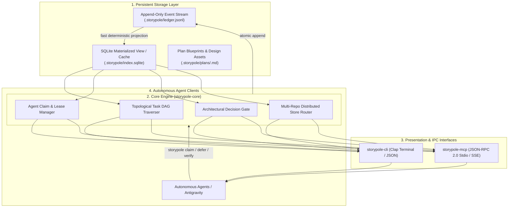

# System Architecture — `storypole`

> **Crates:** `storypole`, `storypole-core`, `storypole-cli`, `storypole-mcp`  
> **Storage Engine:** Append-Only JSONL Event Stream + SQLite Materialized View  
> **Concurrency:** Multi-Process File-Locking & Lease Coordination

---

## 1. System Overview & Dataflow

`storypole` is an autonomous task backlog, dependency DAG scheduler, and Model Context Protocol (MCP) memory server. It models work items as directed acyclic graphs, coordinates branch-isolated agent claim leases, gates tasks on human architectural decisions, and captures multi-commit verification receipts.



---

## 2. Multi-Repository Distributed Store Architecture

In complex multi-repository meta-harnesses (like `gaugeblock`), `storypole` operates in two complementary topologies:

```text
neurosymbolic-suite/               # Multi-repo workspace meta-harness
├── .gaugeblock/storypole/         # Workspace master ledger (cross-cutting epics & tasks)
│   ├── ledger.jsonl               # Suite-wide append-only event stream
│   └── index.sqlite               # Ephemeral SQLite rollup cache
├── miter/
│   └── .storypole/                # Member repository store (miter-specific tasks)
├── storypole/
│   └── .storypole/                # Member repository store (storypole-specific tasks)
└── chalkline/
    └── .storypole/                # Member repository store (chalkline-specific tasks)
```

* **Local Scoped Execution:** When run inside a child repository (`cd miter`), `storypole` reads and writes to `miter/.storypole/ledger.jsonl`.
* **Workspace Rollup & Store Routing:** When run at the root workspace (or with `--dir`), `storypole workspace distribute` partitions tasks from the root ledger into their respective repository ledgers while retaining cross-repo dependency edges.

---

## 3. Crate & Package Topology

### `storypole`
- **Path:** Root package (`src/lib.rs`)
- **Role:** Facade library crate re-exporting `storypole-core` models, traits, and error types for ergonomics.

### `storypole-core`
- **Path:** `crates/storypole-core`
- **Role:** Pure domain engine. Contains event models (`LedgerEvent`), SQLite projection schema and queries, topological sorting algorithms, cycle detection, claim lease expiration calculations, and store discovery routines. Contains zero Clap CLI or transport framing code.

### `storypole-cli`
- **Path:** `crates/storypole-cli`
- **Role:** Command-line binary (`storypole`). Parses Clap command arguments, renders ASCII tables and Mermaid diagrams, handles `--json` structured formatting, and delegates mutations to `storypole-core`.

### `storypole-mcp`
- **Path:** `crates/storypole-mcp`
- **Role:** Model Context Protocol stdio server. Implements JSON-RPC 2.0 protocol over stdin/stdout, exposing tools (`storypole_claim`, `storypole_next`, `storypole_verify`, `storypole_defer`, `storypole_ask_decision`) to AI coding agents.
