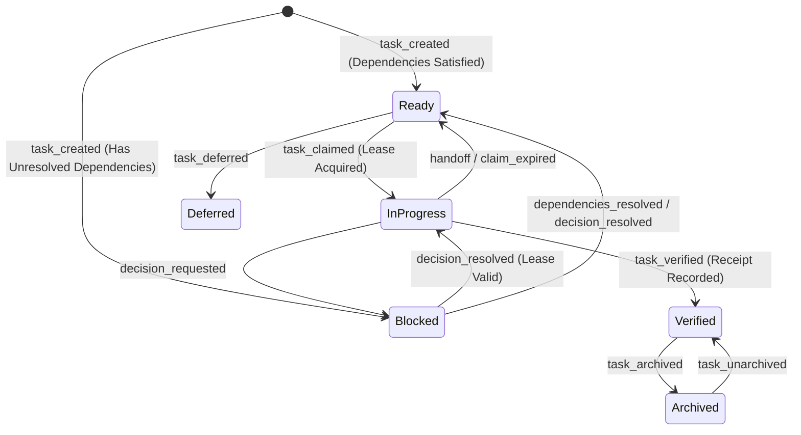
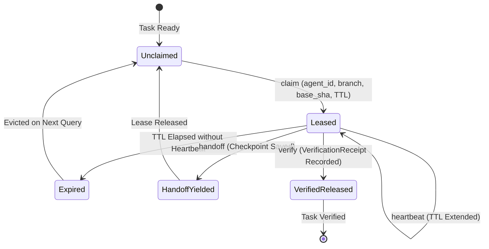

# Behavioral Specifications & Invariants — `storypole`

> **Crates:** `storypole`, `storypole-core`, `storypole-cli`, `storypole-mcp`  
> **Storage Engine:** Append-Only JSONL Event Journal + Ephemeral SQLite Projection  
> **Schema Version:** `1.0`

---

## 1. Core Behavioral Invariants

### Invariant 1: Append-Only Immutable Event Sourcing
* `.storypole/ledger.jsonl` (or `.gaugeblock/storypole/ledger.jsonl`) is the sole ground truth.
* Events are append-only; historical lines are never mutated or deleted in place.
* The SQLite database is a disposable derived projection. Deleting `index.sqlite` and replaying the ledger rebuilds identical state deterministically.

### Invariant 2: Topological DAG Acyclicity
* The dependency graph composed of `EdgeKind::BlockedBy` edges must remain a Directed Acyclic Graph (DAG) at all times.
* Any mutation (`link`, `split`, `add`) that would introduce a cycle is refused with `StorypoleError::DependencyCycleDetected`.

### Invariant 3: Branch-Isolated Time-Bounded Leases
* A task can only have one active `AgentClaim` lease at any given time.
* Every claim lease records the claiming `agent_id`, `git_branch`, and `base_commit_sha`.
* An expired lease (`lease_expires_at_epoch_ms < current_epoch_ms`) automatically frees the task for other agents to claim.

---

## 2. System State Machines

### 2.1 Task Node Lifecycle

### 2.2 Agent Claim Lease Lifecycle

---

## 3. Formal Type Contracts

### Boundary Models, Wire Types & Enums

- **`args::AddArgs`** (`struct`): Command-line options for adding a new task to the backlog.
- **`decision::AgentClaim`** (`struct`): Active agent lease containing agent identity, branch name, and expiration timestamp.
- **`args::AskDecisionArgs`** (`struct`): Command-line options for recording an architectural decision requirement.
- **`args::Cli`** (`struct`): Root command-line parser definition for `storypole-cli`.
- **`args::Commands`** (`enum`): Top-level subcommand variants for the CLI.
- **`mutations::CreateTaskParams`** (`struct`): Domain parameters for instantiating a new task node.
- **`args::DecideArgs`** (`struct`): Command-line options for resolving an architectural decision.
- **`decision::DecisionStatus`** (`enum`): Resolution status of an architectural decision (`Pending`, `Resolved`, `Superseded`).
- **`args::DeferArgs`** (`struct`): Command-line options for quickly deferring out-of-scope defects.
- **`discovery::DiscoveredMember`** (`struct`): Discovered member repository within a multi-repo workspace.
- **`task::EdgeKind`** (`enum`): Directed relationship edge between tasks (`BlockedBy`, `RelatedTo`, `ParentEpic`).
- **`args::HandoffArgs`** (`struct`): Command-line options for executing an agent task handoff.
- **`decision::HandoffPacket`** (`struct`): Structured continuity checkpoint recorded during agent handoffs.
- **`args::InitArgs`** (`struct`): Command-line options for initializing a `.storypole` repository.
- **`events::LedgerEvent`** (`enum`): Master append-only serialization event variant written to `ledger.jsonl`.
- **`args::ListArgs`** (`struct`): Filter and formatting parameters for task listing queries.
- **`args::NextArgs`** (`struct`): Parameters for querying the next topologically unblocked ready task.
- **`plan_args::PlanArgs`** (`struct`): Command-line options for attached plan inspection and manipulation.
- **`plan_args::PlanCommands`** (`enum`): Subcommands for managing attached execution plans.
- **`plan::PlanStep`** (`struct`): Discrete actionable step within a `TaskPlan`.
- **`args::SplitArgs`** (`struct`): Command-line options for splitting an oversized task into subtasks.
- **`config::StorypoleConfig`** (`struct`): Configuration options mapped from `.storypole/config.toml` or `.gaugeblock/config.toml`.
- **`error::StorypoleError`** (`enum`): Strongly typed domain error enum for all `storypole-core` operations.
- **`plan::TaskPlan`** (`struct`): Attached execution blueprint containing markdown design, requirements, and steps.
- **`task::TaskStatus`** (`enum`): Lifecycle status of a task (`Ready`, `InProgress`, `Blocked`, `Verified`, `Deferred`, `Archived`).
- **`decision::VerificationReceipt`** (`struct`): Cryptographic verification record certifying task completion with exit codes and commit SHAs.
- **`config::WorkspaceConfig`** (`struct`): Multi-repository workspace configuration mapping child stores.
